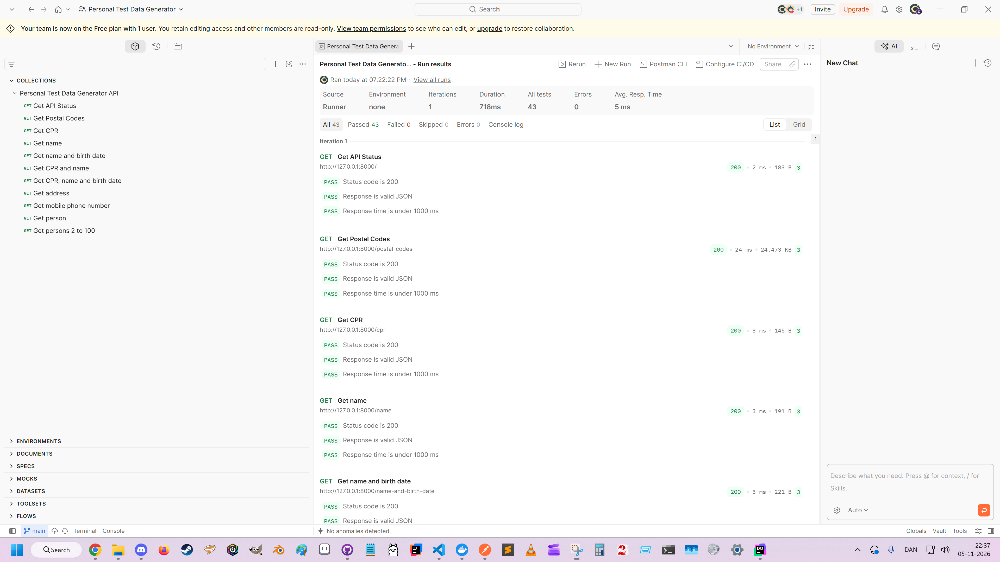
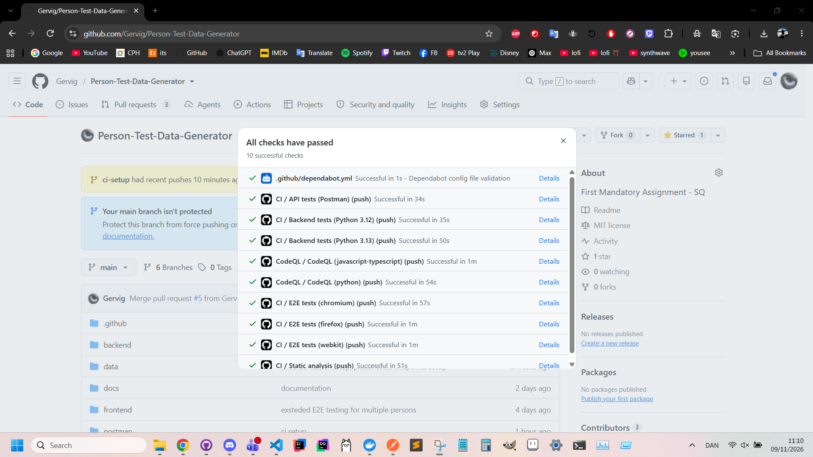

# Personal Test Data Generator

A web application that generates fake information for non-existing Danish persons: names, CPR numbers, dates of birth, addresses and mobile phone numbers. It is built to be tested, and the repository contains the application together with its unit, integration, API and end-to-end tests.

| Part | Technology |
|---|---|
| Backend (REST API) | Python, FastAPI, pydantic, managed with [uv](https://docs.astral.sh/uv/) |
| Database | MariaDB 11 in Docker (postal codes and towns) |
| Frontend | React and Vite (JavaScript) |
| Unit and integration tests | pytest, pytest-cov |
| API tests | Postman |
| End-to-end tests | Playwright |

The original assignment text is in [assignment.md](assignment.md).

## Contents

1. [Quick start](#quick-start)
2. [Repository structure](#repository-structure)
3. [Prerequisites](#prerequisites)
4. [Step 1: Get the code](#step-1-get-the-code)
5. [Step 2: Database](#step-2-database)
6. [Step 3: Backend](#step-3-backend)
7. [Step 4: Frontend](#step-4-frontend)
8. [Running the tests](#running-the-tests)
9. [API tests with Postman](#api-tests-with-postman)
10. [API reference](#api-reference)
11. [Continuous integration and delivery (CI/CD)](#continuous-integration-and-delivery-cicd)
12. [More documentation](#more-documentation)
13. [Troubleshooting](#troubleshooting)

## Quick start

For readers who have the prerequisites installed (see [Prerequisites](#prerequisites)) and want the application running. Use two terminals. Every step is explained in the sections below.

**Terminal 1: database and backend**

```
git clone https://github.com/Gervig/Person-Test-Data-Generator.git
cd Person-Test-Data-Generator/backend
docker compose up -d
```

Wait a few seconds until the database container is ready, then load the data and start the API:

```
docker cp ../data/addresses.sql test-data-mariadb:/tmp/addresses.sql
docker exec -i test-data-mariadb mariadb -uroot -plocal_dev_password addresses -e "source /tmp/addresses.sql"
cp .env.example .env
uv sync
uv run uvicorn app.main:app --reload
```

**Terminal 2: frontend**

```
cd Person-Test-Data-Generator/frontend
npm install
npm run dev
```

Open <http://localhost:5173> for the application and <http://127.0.0.1:8000/docs> for the interactive API documentation.

## Repository structure

```
Person-Test-Data-Generator/
├── backend/
│   ├── app/
│   │   ├── main.py                  FastAPI application (entry point)
│   │   ├── database.py              MariaDB connection pool, configured from .env
│   │   ├── data_loader.py           Loads data/person-names.json
│   │   ├── generators.py            Random data generators
│   │   ├── exceptions.py
│   │   ├── routers/                 HTTP routes: health, postal_codes, address, person
│   │   ├── controllers/             Thin layer between routes and services
│   │   ├── services/                Application logic: address_service, person_service
│   │   ├── repositories/            Database access: postal_code_repository
│   │   └── models/                  Pydantic models and validation rules
│   ├── tests/                       pytest suite
│   ├── compose.yaml                 MariaDB container
│   ├── .env.example                 Template for the database settings
│   └── pyproject.toml               Dependencies and pytest configuration
├── frontend/
│   ├── src/
│   │   ├── main.jsx                 Entry point
│   │   ├── App.jsx                  The user interface
│   │   ├── api/personApi.js         All calls to the backend API
│   │   ├── App.css, index.css       Styles
│   │   └── assets/                  Images
│   ├── tests/                       Playwright end-to-end tests (*.spec.js)
│   ├── public/                      Static files (icons)
│   ├── vite.config.js               Vite settings, including the /api proxy
│   ├── playwright.config.js         Playwright settings
│   ├── eslint.config.js             ESLint rules
│   └── package.json
├── data/
│   ├── addresses.sql                MariaDB dump with the postal codes and towns
│   └── person-names.json            Names and genders used by the generators
├── postman/                         Postman collection for the API tests
├── docs/                            Documentation, screenshots and the test design PDF
├── scripts/                         PowerShell scripts behind the .cmd files (Windows)
└── setup.cmd, run.cmd, test.cmd, cov.cmd, covhtml.cmd   Windows shortcuts
```

A backend request passes through the layers in this order: router, controller, service, then the repository (database) or the generators. The pydantic models validate all generated data.

### Windows shortcuts

The `.cmd` files in the repository root start the PowerShell scripts in `scripts/` with the needed execution policy. They are optional; everything can also be done with the commands in this README.

| File | What it does |
|---|---|
| `setup.cmd` | Checks Python and Docker, installs uv if it is missing, runs `uv sync`, checks that `backend/.env` exists and starts the database container. It does not create `.env` and does not load the data, so Step 2.2 and Step 3.1 are still needed |
| `run.cmd` | Starts the API on port 8000 |
| `test.cmd` | Runs the backend tests |
| `cov.cmd` | Runs the backend tests with coverage in the terminal |
| `covhtml.cmd` | Runs the backend tests with coverage and opens the HTML report |

## Prerequisites

| Tool | Version | Used for |
|---|---|---|
| Git | Any recent version | Getting the code |
| Python | 3.12 or newer (the developers use 3.12 and 3.13) | Backend |
| uv | Any recent version, see <https://docs.astral.sh/uv/getting-started/installation/> | Installs and runs the backend dependencies |
| Docker Desktop | Any recent version | Runs MariaDB 11 in a container |
| Node.js and npm | Node 20.19 or newer, or 22.12 or newer | Frontend (Vite 8 and ESLint 10 require these versions) |
| Postman | Current desktop app | API tests (optional, only to run the Postman collection) |

Check the installed versions:

```
git --version
python --version
uv --version
docker --version
node --version
npm --version
```

**macOS and Linux:** the Python package `mariadb` is built against the MariaDB Connector/C library. Install it before running `uv sync`, otherwise the installation stops with `mariadb_config not found`:

- Debian and Ubuntu: `sudo apt install libmariadb-dev`
- macOS (Homebrew): `brew install mariadb-connector-c`

On Windows no extra installation has been needed.

## Step 1: Get the code

```
git clone https://github.com/Gervig/Person-Test-Data-Generator.git
cd Person-Test-Data-Generator
```

## Step 2: Database

The database runs in a Docker container. The configuration is in `backend/compose.yaml`:

| Setting | Value |
|---|---|
| Image | `mariadb:11` |
| Container name | `test-data-mariadb` |
| Port | `3306` |
| Database | `addresses` |
| Root password | `local_dev_password` (for local development only) |
| Storage | Docker volume `mariadb_data` |

### 2.1 Start the container

Start Docker Desktop and wait until it is running. Then, from the `backend` folder:

```
cd backend
docker compose up -d
docker compose ps
```

The first start takes a few seconds while MariaDB initialises. Wait until the container is ready before the next step. `docker logs test-data-mariadb` should end with a line that says `ready for connections`.

### 2.2 Load the postal codes

The database is filled from the SQL dump `data/addresses.sql`. The dump is already prepared for the `addresses` database, so it does not need to be edited.

From the `backend` folder, copy the file into the container:

```
docker cp ../data/addresses.sql test-data-mariadb:/tmp/addresses.sql
```

Open the MariaDB console in the container:

```
docker exec -it test-data-mariadb mariadb -uroot -plocal_dev_password addresses
```

At the `MariaDB [addresses]>` prompt, run the dump and leave the console:

```sql
source /tmp/addresses.sql
exit
```

The same import without the interactive console:

```
docker exec -i test-data-mariadb mariadb -uroot -plocal_dev_password addresses -e "source /tmp/addresses.sql"
```

The dump can be run again at any time. It drops and recreates the table `postal_code`.

### 2.3 Check the data

```
docker exec -it test-data-mariadb mariadb -uroot -plocal_dev_password addresses -e "SELECT COUNT(*) FROM postal_code;"
```

The result should be **589** rows. The table has the columns `cPostalCode` and `cTownName`. For example, `1301` is `København K`.

### 2.4 Stop and start the database

```
docker compose stop     # stop, the data is kept
docker compose up -d    # start again
```

Do not run `docker compose down -v` unless you want to delete the stored data. Then Step 2.2 has to be repeated.

## Step 3: Backend

Run all commands in this section from the `backend` folder.

### 3.1 Configure the database connection

Copy the template. The default values match the Docker container from Step 2:

```
cp .env.example .env
```

(In Windows PowerShell, `cp` is an alias for `Copy-Item`.) The file `.env` is ignored by Git. It contains:

| Variable | Default in `.env.example` | Meaning |
|---|---|---|
| `DB_HOST` | `localhost` | Database host |
| `DB_PORT` | `3306` | Database port |
| `DB_USER` | `root` | Database user |
| `DB_PASSWORD` | `local_dev_password` | Database password (required) |
| `DB_NAME` | `addresses` | Database name |

### 3.2 Install the dependencies

```
uv sync
```

This creates the virtual environment `backend/.venv` and installs the dependencies from `pyproject.toml`, including the test tools. If uv needs a Python version that is not installed, it can download one.

### 3.3 Start the API

```
uv run uvicorn app.main:app --reload
```

The API now runs on port 8000:

- Status: <http://127.0.0.1:8000/>
- Interactive documentation (Swagger UI): <http://127.0.0.1:8000/docs>
- Example: <http://127.0.0.1:8000/person>

Keep this terminal open. Stop the server with `Ctrl+C`.

On Windows, `run.cmd` in the repository root does the same.

## Step 4: Frontend

Open a second terminal. Run all commands in this section from the `frontend` folder. The backend (Step 3) must be running.

```
cd frontend
npm install
npm run dev
```

The application is available at <http://localhost:5173>.

### Using the application

1. Select what to generate in the drop-down list: a person, a list of persons, a CPR number, a name, an address, a mobile phone number, or one of the combinations of name, CPR number and date of birth.
2. For a list of persons, enter a number from 2 to 100.
3. Click **Generate**. The response of the API is shown as JSON below the button. Errors, for example a number outside the range, are shown in red.

### How the frontend reaches the backend

The browser calls `/api/...` on the frontend server. Vite forwards the call to `http://localhost:8000/...` and removes the `/api` prefix. This is configured in `frontend/vite.config.js`, and the calls themselves are in `frontend/src/api/personApi.js`. No CORS settings are needed. The backend must run on port 8000. If the port is changed, change `target` in `vite.config.js` and restart `npm run dev`.

### Other frontend commands

| Command | Purpose |
|---|---|
| `npm run dev` | Development server with hot reload on port 5173 |
| `npm run build` | Production build into `frontend/dist` |
| `npm run preview` | Serves the production build (the `/api` proxy is only available in `npm run dev`) |
| `npm run lint` | Checks the code with ESLint |

## Running the tests

### Backend: unit and integration tests (pytest)

From the `backend` folder:

```
uv run pytest -v
```

All tests should pass (160 tests at the time of writing). The model tests use named valid and invalid partitions and boundary values. Only the two tests in `tests/test_database/` need the running MariaDB container with the data from Step 2. All other tests run without a database, because they replace the database access with test doubles.

| Folder | What it tests |
|---|---|
| `tests/test_models/` | Validation rules of `PostalCode`, `Address` and `Person` |
| `tests/test_generators/` | Properties of the generated data, for example the CPR number and phone number rules |
| `tests/test_services/` | Generated addresses and persons pass the model validation |
| `tests/test_repositories/` | Postal code repository, including error handling and closing of connections |
| `tests/test_routes/` | Limits of the `count` parameter of the API |
| `tests/test_api_contract.py` | Keys and types in the API responses |
| `tests/test_database/` | Integration test against MariaDB: connection and the `/postal-codes` endpoint |

Shared test data (a valid postal code, address and person) is in `tests/conftest.py`.

Code coverage, including branch coverage and the lines that are not covered:

```
uv run pytest --cov=app --cov-branch --cov-report=term-missing
```

For an HTML report in `backend/htmlcov` (open `htmlcov/index.html`), add `--cov-report=html`.

On Windows, the shortcuts in the repository root run the same commands from the project's virtual environment (run `uv sync` first): `test.cmd` runs the tests, `cov.cmd` shows the coverage in the terminal, and `covhtml.cmd` also writes and opens the HTML report.

### Frontend: end-to-end tests (Playwright)

The end-to-end tests open the application in a real browser, generate data through the user interface and check the result. They need the complete system, so before running them:

1. The database container is running with the data loaded (Step 2).
2. The backend is running on port 8000 (Step 3).
3. The frontend is running on port 5173 (`npm run dev`, Step 4).

Playwright does not start these itself. Then, in a third terminal, from the `frontend` folder:

```
npx playwright install          # once: downloads the browsers
npx playwright test             # runs the tests in Chromium, Firefox and WebKit
npx playwright test --project=chromium    # only one browser
npx playwright show-report      # opens the HTML report of the last run
```

On Linux, use `npx playwright install --with-deps` to also install the system libraries that the browsers need.

There are 14 tests per browser in `frontend/tests/`, one file per functionality:

| File | Checks |
|---|---|
| `cpr.spec.js` | A CPR number has 10 digits |
| `name.spec.js` | First name, last name and gender (`male` or `female`) |
| `name_and_birthdate.spec.js` | Name, gender and a date of birth in the format `yyyy-mm-dd` |
| `cpr_and_name.spec.js` | CPR number, name and gender |
| `cpr_name_and_birthdate.spec.js` | CPR number, name, gender and date of birth |
| `address.spec.js` | Street, number and a four-digit postal code with a town |
| `phone_number.spec.js` | A mobile phone number has 8 digits |
| `person.spec.js` | All fields of one person |
| `persons.spec.js` | Default of 2 persons, an explicit 2, 100 persons, and rejection (HTTP 422) of 1 and 101 |
| `example.spec.js` | The start page loads |

### Frontend: static analysis

From the `frontend` folder: `npm run lint`.

## API tests with Postman

The Postman collection **Personal Test Data Generator API** is in `postman/collections/Personal Test Data Generator API/`. It is stored in Postman's file format for Git, with one file per request. It contains one request for each endpoint:

status, postal codes, CPR, name, name and birth date, CPR and name, CPR, name and birth date, address, mobile phone number, person, and persons (2 to 100).

**Tests in the collection**

- Every request checks that the status code is 200, that the response is valid JSON, and that the response time is under 1000 ms.
- The request *Get persons 2 to 100* also sends ten extra requests with different values of `count` (1, 2, 3, 99, 100, 101, 0, -1, `abc` and empty). It checks that the values outside 2 to 100 give HTTP 422, and that valid values return the right number of persons with the expected fields.

**Run the collection**

1. Start the database and the backend (Steps 2 and 3).
2. In Postman, open the collection. Either connect the workspace to the cloned repository with Postman's Git integration, or drag the folder `postman/collections/Personal Test Data Generator API` into Postman's **Import** window.
3. Set the collection variable `base_url` to `http://127.0.0.1:8000`. Open the collection, then the **Variables** tab, and enter the value as both initial and current value. The variable is empty in the repository, and the requests use it as `{{base_url}}/...`.
4. Open the collection's menu, choose **Run collection**, and click **Run**.

All 43 tests should pass:



## API reference

All endpoints use the method `GET`, and there are no URL prefixes. Open <http://127.0.0.1:8000/docs> for parameters and example responses.

| Endpoint | Response |
|---|---|
| `/` | Status message: `{"message": "Personal Test Data Generator API is running!"}` |
| `/cpr` | `cpr` |
| `/name` | `first_name`, `last_name`, `gender` |
| `/name-and-birth-date` | Name and gender, plus `date_of_birth` |
| `/cpr-and-name` | `cpr` plus name and gender |
| `/cpr-name-and-birth-date` | `cpr`, name, gender and `date_of_birth` |
| `/address` | `street`, `number`, `floor`, `door` and `postal_code` (with `postal_code` and `town_name`) |
| `/mobile-phone-number` | `mobile_phone_number` |
| `/person` | All fields of one person: name, gender, `date_of_birth`, `cpr`, `mobile_phone_number` and `address` |
| `/persons?count=N` | `{"persons": [...]}` with N complete persons. `count` is from 2 to 100, default 2; other values give HTTP 422 |
| `/postal-codes` | All postal codes from the database as a list of `postal_code` and `town` |

If the database cannot be reached, the endpoints that use it respond with HTTP 500 and `{"detail": "Could not retrieve data from the database."}`.

### Data rules

| Field | Rule |
|---|---|
| Gender | `male` or `female` |
| CPR number | 10 digits. The first six are the date of birth as `ddMMyy`. The last digit is even for women and odd for men |
| Mobile phone number | 8 digits, starting with one of the permitted Danish mobile prefixes |
| Postal code | 4 digits, chosen at random from the database |
| Address number | 1 to 999, optionally followed by one uppercase letter, for example `43B` |
| Address floor | `st`, or a number from 1 to 99 |
| Address door | `th`, `mf` or `tv`; or a number from 1 to 50; or a lowercase letter, an optional dash and one to three digits, for example `c3` or `d-14` |

## Continuous integration and delivery (CI/CD)

The project has a continuous integration (CI) pipeline built with GitHub Actions. Every change is checked automatically by static analysis, unit tests, integration tests, API tests and end-to-end tests. Continuous delivery (CD) is not set up yet; see [Continuous delivery (CD)](#continuous-delivery-cd).

[](https://github.com/Gervig/Person-Test-Data-Generator/actions/workflows/ci.yml)

### CI tool

| | |
|---|---|
| Tool | GitHub Actions |
| Pipeline file | [`.github/workflows/ci.yml`](.github/workflows/ci.yml) |
| Shared setup step | [`.github/actions/setup-backend/action.yml`](.github/actions/setup-backend/action.yml) installs the MariaDB client library and uv, runs `uv sync`, and optionally starts MariaDB and loads `data/addresses.sql` |
| Runs on | GitHub-hosted runners (`ubuntu-latest`) |
| Triggers | Every push to `main`, every pull request, and manual runs (**Actions → CI → Run workflow**) |
| Security scan | [`.github/workflows/codeql.yml`](.github/workflows/codeql.yml): CodeQL for Python and JavaScript on push and pull requests to `main`, and weekly |
| Dependency updates | [`.github/dependabot.yml`](.github/dependabot.yml): Dependabot opens pull requests for outdated GitHub Actions |

A new push to the same branch cancels the run that is still in progress.

### Pipeline jobs

The four jobs run in parallel and are independent of each other.

| Job | What it does | Tools |
|---|---|---|
| **Static analysis** | Lints and type checks the backend and lints the frontend | ruff, bandit, mypy, ESLint |
| **Backend tests** (Python 3.12 and 3.13) | Runs the unit tests, then the integration tests against a MariaDB container with the imported data, and creates a coverage report | pytest, pytest-cov |
| **API tests (Postman)** | Starts MariaDB and the API, then runs the Postman collection in `postman/collections/` | Postman CLI |
| **E2E tests** (Chromium, Firefox, WebKit) | Starts MariaDB, the API and the frontend, then runs the Playwright tests once per browser | Playwright |

Details per job:

1. **Static analysis**
   - `ruff check` (rules for style, imports, bugs, complexity and security), `bandit` (security scan) and `mypy` (type checking) run in `backend`. The configuration is in `backend/pyproject.toml`.
   - `npm run lint` runs ESLint in `frontend`.
2. **Backend tests**
   - Unit tests: `pytest --ignore=tests/test_database`.
   - Integration tests: `pytest tests/test_database`, against the MariaDB container started from `backend/compose.yaml`.
   - Coverage is measured with branch coverage over both steps. The pipeline fails if coverage drops below **90%** (`fail_under` in `backend/pyproject.toml`).
3. **API tests**
   - The API is started with uvicorn on `http://127.0.0.1:8000`, and the collection's `base_url` variable points there.
   - The Postman CLI is installed and runs `postman collection run "postman/collections/Personal Test Data Generator API"`. The job fails if any Postman test fails.
4. **E2E tests**
   - The Playwright browser is installed, the API and the Vite dev server (`http://localhost:5173`) are started, and `npx playwright test --project=<browser>` runs the specs.
   - The three browsers run as separate parallel jobs, so one failing browser does not stop the others.

### Configuration and secrets

| Name | Purpose | Where it is set |
|---|---|---|
| `DB_HOST`, `DB_PORT`, `DB_USER`, `DB_PASSWORD`, `DB_NAME` | Connect to the test MariaDB | `env:` block at the top of `ci.yml`. The values match `backend/compose.yaml`. |

The database password is the same throw-away value as in the local development setup. It protects a container that only exists while the job runs, so no repository secret is needed. The pipeline does not use any other secrets: the Postman collection runs from the files in the repository, so no Postman API key is required.

### Reports and artifacts

After a run, open it under the **Actions** tab. The run summary lists the jobs and their results, and the **Artifacts** section at the bottom contains:

| Artifact | Content |
|---|---|
| `coverage-python-3.12`, `coverage-python-3.13` | HTML and XML coverage report (`htmlcov/`, `coverage.xml`) |
| `playwright-report-chromium`, `-firefox`, `-webkit` | Playwright HTML report for each browser |
| `api-log`, `logs-<browser>` | API and frontend logs, uploaded only when a job fails |

The static analysis output (ruff, bandit, mypy and ESLint) is in the job log of **Static analysis**. Ruff findings also appear as annotations on the changed lines in a pull request. CodeQL results are under **Security → Code scanning**.

### Running the checks locally

The same checks can be run on your own machine before pushing. Start the database first (see [Step 2: Database](#step-2-database)), then run from `backend`:

```powershell
cd backend
uv run ruff check .
uv run bandit -c pyproject.toml -r app
uv run mypy
uv run pytest --cov=app --cov-branch --cov-report=term-missing
```

and from `frontend`:

```powershell
cd frontend
npm run lint
```

The API tests and end-to-end tests are described in [API tests with Postman](#api-tests-with-postman) and [Frontend: end-to-end tests (Playwright)](#frontend-end-to-end-tests-playwright).

### Continuous delivery (CD)

> **TODO:** Continuous delivery is not set up yet. The assignment requires CI only. Decide whether to add a delivery step, for example:
>
> - Build Docker images of the backend and frontend
> - Deploy to a hosting service
> - No CD, so the pipeline ends after the checks

### Screenshots



## More documentation

| Document | Content |
|---|---|
| [docs/Black-box_test_design.pdf](docs/Black-box_test_design.pdf) | The black-box test design: valid and invalid equivalence partitions, boundary values and decision tables behind the test cases |
| [docs/assignment.md](docs/assignment.md) | The assignment text |

## Troubleshooting

| Problem | Cause and solution |
|---|---|
| `uv` is not recognized | Restart the terminal after installing uv. On Windows, uv is installed in `%USERPROFILE%\.local\bin`; add that folder to `PATH`. |
| `uv sync` fails with `mariadb_config not found` | The MariaDB Connector/C library is missing on macOS or Linux. See [Prerequisites](#prerequisites). |
| `DB_PASSWORD must be configured` or HTTP 500 from the API | The file `backend/.env` is missing or empty. Copy `.env.example` (Step 3.1) and restart the API. |
| `Can't connect to server` or HTTP 500 from the API | The container is not running or not ready. Check with `docker compose ps` and `docker logs test-data-mariadb`. |
| The data is missing: `/postal-codes` returns an empty list, or the table does not exist | Step 2.2 was not done. Repeat it. |
| Port 3306 is already in use | Another MariaDB or MySQL server is running. Stop it, or change the left port in `backend/compose.yaml` (`"3307:3306"`) and set `DB_PORT=3307` in `.env`. |
| Port 8000 or 5173 is already in use | Stop the other program. If the backend port changes, update `target` in `frontend/vite.config.js`. |
| The frontend shows `Request failed: 500` or a proxy error | The backend or the database is not running. Check <http://127.0.0.1:8000/> in the browser. |
| `npm install` fails with engine warnings or errors | Node.js is too old. Install Node 20.19 or newer, or 22.12 or newer. |
| Playwright: `Executable doesn't exist` | Run `npx playwright install` once. |
| Playwright: `connection refused` or the tests time out | The frontend, backend or database is not running. See the three conditions at the start of the end-to-end section. |
| PowerShell blocks the scripts in `scripts/` | Use the `.cmd` files in the repository root. They start the scripts with the needed execution policy. |
| Postman requests fail with an invalid URL | The collection variable `base_url` is empty. See step 3 of the Postman section. |
